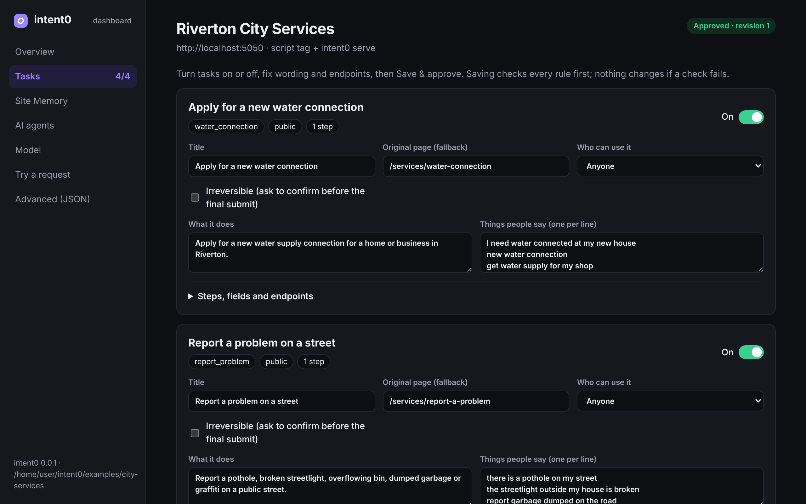

# Intent0

### A simpler way to use the websites you already have.

Tell a website what you want to do. Intent0 turns its approved tasks and help content into a focused, guided experience—while the website keeps its own pages, APIs, and data.



*The Intent0 dashboard lets a site owner review and control the tasks visitors can use.*

## What it does

- **Guided tasks:** Visitors describe a goal—such as applying, booking, reporting, or tracking—and Intent0 builds a step-by-step flow from tasks the site owner has approved.
- **Answers from site content:** Intent0 can answer questions using the site’s own docs and pages, with links back to the sources.
- **AI agent tools:** The same approved tasks and site search can be offered to AI agents through MCP and WebMCP.

Intent0 is designed to work with a site’s existing APIs. If a generated experience cannot be built or a request fails, visitors can return to the site’s original page.

## Try the demo

The Intent0 website runs the product on its own docs. Start it locally:

```bash
pnpm install
pnpm --filter @intent0/site dev
```

Open [http://localhost:3000](http://localhost:3000) and choose **Ask this site**. The demo works without adding a model key.

To open the local dashboard for the demo site, run:

```bash
pnpm dashboard
```

## Install the CLI

The package is named `intent0`. Once its first public npm release is available, install it in your project:

```bash
npm install intent0
npx intent0 init
```

The first public release is still being prepared. Until then, try the site demo above or build a local package from this repository:

```bash
pnpm pack:intent0
```

That creates a tarball under `packages/intent0`. For a Next.js App Router site, install the tarball and run `npx intent0 init`. For other sites, run the CLI with `npx --package=<path-to-tarball> intent0 init` and `npx --package=<path-to-tarball> intent0 serve`.

## How setup works

1. Run `intent0 init` in your website project. It scans the project’s routes and forms and drafts possible tasks.
2. Review and approve the tasks in the terminal or with `intent0 dashboard`.
3. Intent0 adds the site integration and builds Site Memory from your content.
4. Visitors ask in their own words. Intent0 presents a guided experience using only approved tasks and the site’s own endpoints.

The site owner keeps control of which tasks are enabled, their wording, and the endpoints they call. The model does not receive visitors’ form values.

## Commands

| Command | Purpose |
|---|---|
| `intent0 init` | Scan a project, draft tasks, build Site Memory, and set up the integration |
| `intent0 dashboard` | Review tasks, change wording and endpoints, approve revisions, and try requests |
| `intent0 index` | Rebuild Site Memory from project docs and site pages |
| `intent0 approve` | Validate the edited manifest and approve it |
| `intent0 serve` | Run the Intent0 server for sites without the Next.js integration |
| `intent0 mcp` | Make approved tasks and site search available to desktop agents over MCP |

For a non-Next.js site, `intent0 serve` provides the backend, while a script tag adds the browser interface. See the [integration guides](apps/site/content/docs) for setup details.

## AI agents

A running site can expose approved public tasks and `search_site` over MCP. Signed-in tasks remain in the browser. Irreversible actions require explicit confirmation.

For a desktop agent that starts its own MCP server, add a configuration like this and replace the directory and site URL:

```json
{
  "mcpServers": {
    "my-site": {
      "command": "npx",
      "args": [
        "intent0",
        "mcp",
        "--dir",
        "/path/to/your/site",
        "--site",
        "http://localhost:3000"
      ]
    }
  }
}
```

## Safety and control

- Only approved, enabled tasks are offered; destructive tasks are disabled by default.
- Required verification steps cannot be skipped.
- Irreversible submissions require the visitor’s confirmation.
- Generated interfaces use an allowlisted component set and are validated before display.
- The model receives the visitor’s request, not the values they enter into forms.
- If the guided experience fails, the original site remains available.

## Repository layout

| Path | Contents |
|---|---|
| `packages/schema` | Zod schemas for manifests, tasks, pages, and Site Memory |
| `packages/core` | Flow state, validation, search, and agent tools |
| `packages/adapter` | Intent handling, experience generation, and MCP over HTTP |
| `packages/react` | Browser interface, page renderer, and WebMCP tools |
| `packages/intent0` | CLI, server, React exports, and browser bundle |
| `apps/site` | Product website, docs, demo, and dashboard |
| `fixtures` | Example manifest used by the test suite |

## Development

Requires Node.js 20 or newer and pnpm.

```bash
pnpm install
pnpm check
pnpm --filter @intent0/site dev
```

## License

Intent0 is released under [The Unlicense](LICENSE), dedicating the project to the public domain.

